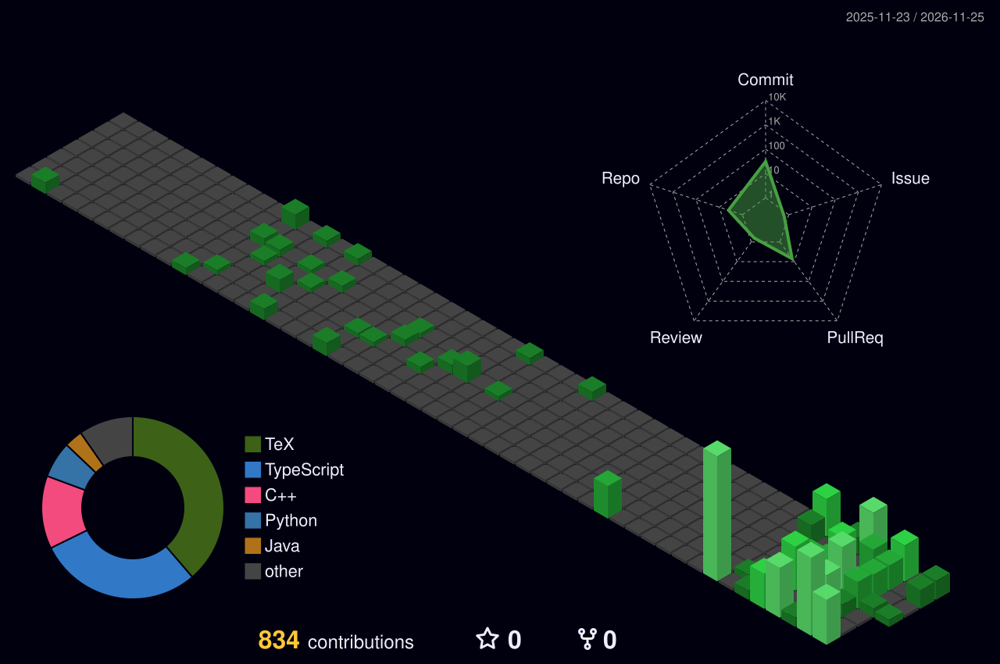

<p align="center">
  
</p>

<p align="center">
  <a href="https://www.linkedin.com/in/mateusz-kierepka03" target="_blank">
    
  </a>
  <a href="mailto:mateusz.kierepka03@gmail.com">
    
  </a>
</p>

<h2 align="center">👨‍💻 About Me</h2>

```java
public class MateuszKierepka {

    String role     = "Junior Java Developer @ Brown Brothers Harriman";
    String location = "Kraków, Poland";

    String[] education = {
        "MSc CS, Cybersecurity @ Cracow University of Technology (2026 - now)",
        "BEng CS, Software Engineering @ Lublin University of Technology (2022 - 2026)"
    };

    String[] focus = {
        "Backend in Java & Spring Boot",
        "Full stack web apps (Next.js, Angular)",
        "Security",
        "AI agents"
    };

    String achievement = "🥉 3rd place @ HackYeah 2026, Defence category";
    String approach    = "Clean, tested and maintainable code";
}
```

<h2 align="center">💼 Experience</h2>

<table>
  <tr>
    <td width="1000">
      🏦 <b><a href="https://www.bbh.com">Brown Brothers Harriman</a></b> · Kraków, Poland · Hybrid<br/>
      <br/>
      <b>Junior Java Developer</b> · Full-time · <i>Sep 2026 - Present</i><br/>
      <b>Java Developer Intern</b> · Internship · <i>Apr 2026 - Sep 2026</i><br/>
      <br/>
      <br/>
      <sub>Java 17/21 · Spring Boot 3.x/4.x · Gradle · Jenkins (Jenkinsfile pipelines) · OpenShift · Bash</sub>
    </td>
  </tr>
</table>

<h2 align="center">🔭 Currently Working On</h2>

- 🏋️ **TrainMe** - building a booking platform for personal trainers and their clients
- 🛡️ **CertCordon** - extending our HackYeah 2026 project with the team
- 🤖 **AI engineering** - learning how to work with AI agents and how to design agent-based systems

<h2 align="center">🚀 Projects</h2>

<table>
  <tr>
    <td colspan="2" valign="top">
      <h3>🛡️ CertCordon</h3>
      <b>🥉 3rd place at HackYeah 2026 (Defence category)</b> · built in a team of 5<br/>
      A cybersecurity platform that detects phishing lookalike domains and blocks them before they reach users.<br/><br/>
      
    </td>
  </tr>
  <tr>
    <td width="50%" valign="top">
      <h3>🏋️ TrainMe</h3>
      A platform that connects personal trainers with clients: trainers publish their availability, clients find a trainer and book a session.
      <ul>
        <li>Clients search trainers by city, gym, specialization, price and availability, and save their favourites</li>
        <li>Trainers manage their schedule, accept or decline bookings and see today's trainings and income on a dashboard</li>
        <li>Built-in chat between clients and trainers, plus calendar export to Google Calendar or Outlook</li>
        <li>Trusted reviews: only clients who completed a training can rate a trainer</li>
        <li>Admin panel for user management, review moderation and support tickets; Polish and English versions</li>
      </ul>
      
    </td>
    <td width="50%" valign="top">
      <h3>🚗 BuyMePls</h3>
      A local assistant for car auctions (IAAI): it collects the listings you browse, scores them and ranks the best offers.
      <ul>
        <li>Chrome extension (Manifest V3) that collects listing data while you browse</li>
        <li>FastAPI + SQLAlchemy backend with explainable, rule-based scoring</li>
        <li>Optional local vision LLM (Ollama, Qwen3-VL) that adds a summary and its own rating, running on your own GPU with no cloud</li>
        <li>React + TypeScript dashboard with the offer ranking</li>
      </ul>
      
    </td>
  </tr>
  <tr>
    <td width="50%" valign="top">
      <h3>👨‍👩‍👧 <a href="https://github.com/MateuszKierepka/kiddify">Kiddify</a></h3>
      A family activity hub: a web app for parents (Angular) and a native Android app for children (Java).
      <ul>
        <li>REST API in Spring Boot with Spring Data JPA and PostgreSQL</li>
        <li>JWT authentication with BCrypt password hashing</li>
        <li>Real-time parent-child updates over WebSockets</li>
        <li>Child login with dynamically generated QR codes and a PIN</li>
        <li>Family gallery on MinIO object storage, CI/CD with GitHub Actions, unit tests in JUnit</li>
      </ul>
      
    </td>
    <td width="50%" valign="top">
      <h3>💪 <a href="https://github.com/MateuszKierepka/GymApp">GymApp</a></h3>
      A full stack app for planning workouts and tracking progress.
      <ul>
        <li>Authentication with JWT and OAuth 2.0</li>
        <li>AI-generated workout plans (Mistral via Ollama)</li>
        <li>Live workout mode and PDF export of workout plans</li>
        <li>Admin panel for user management; backend in CRUD / MVC architecture</li>
      </ul>
      
    </td>
  </tr>
</table>

<h2 align="center">⚒️ Tech Stack</h2>

<table align="center">
  <tr>
    <td align="right"><b>Backend</b></td>
    <td></td>
  </tr>
  <tr>
    <td align="right"><b>Frontend</b></td>
    <td></td>
  </tr>
  <tr>
    <td align="right"><b>Databases</b></td>
    <td></td>
  </tr>
  <tr>
    <td align="right"><b>DevOps &amp; Tools</b></td>
    <td></td>
  </tr>
</table>

<h2 align="center">⚡ GitHub Activity</h2>

<p align="center">
  <picture>
    <source media="(prefers-color-scheme: dark)" srcset="https://raw.githubusercontent.com/MateuszKierepka/MateuszKierepka/main/profile-3d-contrib/profile-night-green.svg" />
    <source media="(prefers-color-scheme: light)" srcset="https://raw.githubusercontent.com/MateuszKierepka/MateuszKierepka/main/profile-3d-contrib/profile-green-animate.svg" />
    
  </picture>
</p>

<p align="center">
  <picture>
    <source media="(prefers-color-scheme: dark)" srcset="https://raw.githubusercontent.com/MateuszKierepka/MateuszKierepka/output/github-snake-dark.svg" />
    <source media="(prefers-color-scheme: light)" srcset="https://raw.githubusercontent.com/MateuszKierepka/MateuszKierepka/output/github-snake.svg" />
    
  </picture>
</p>

<p align="center">
  <code>$ exit</code><br/>
  Thanks for visiting! 👋 Let's connect on <a href="https://www.linkedin.com/in/mateusz-kierepka03">LinkedIn</a>.
</p>
